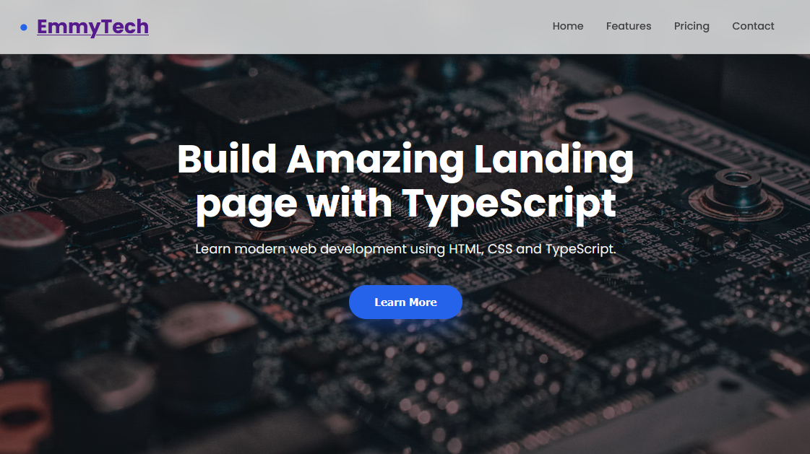
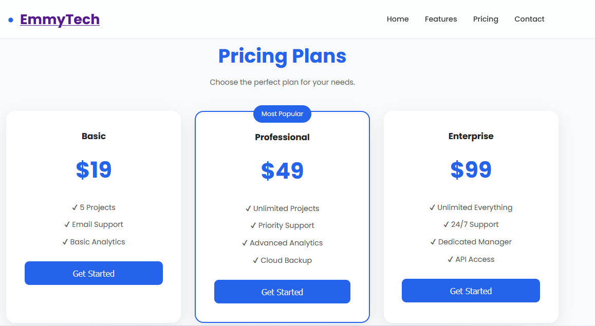
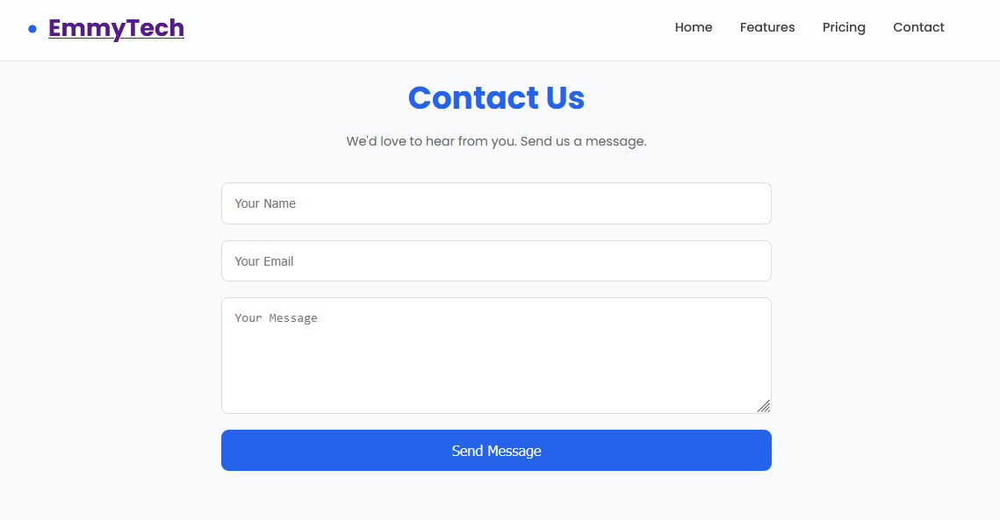

# TypeScript Landing Page

A modern landing page project built with TypeScript, React, and Vite, focused on clean code, maintainability, responsive design, and a professional web experience.

**Repository:** [emmy-tech247/typscript-landing-page](https://github.com/emmy-tech247/typscript-landing-page)

## Screenshots

### 1. Homepage



### 2. Pricing Section



### 3. Contact



## Overview

This project demonstrates the development of a landing page using TypeScript and modern frontend development tools. It serves as a foundation for building attractive web pages for businesses, products, services, and personal projects.

The project emphasizes readable code, structured development, and a maintainable foundation for future enhancements.

## Features

- TypeScript-powered development
- React component-based architecture
- Vite development and build tooling
- Modern landing page structure
- Maintainable and organized code
- Responsive design
- Extendable structure for additional sections and functionality
- GitHub-based version control
- Ready for customization and deployment

## Technology Stack

- **Language:** TypeScript
- **Frontend:** React
- **Build tool:** Vite
- **Runtime and package management:** Node.js and npm
- **Version control:** Git and GitHub

## Getting Started

### Prerequisites

Install the following:

- Node.js
- npm
- Git

Check your installation:

```bash
node --version
npm --version
git --version
```

### 1. Clone the repository

```bash
git clone https://github.com/emmy-tech247/typscript-landing-page.git
```

### 2. Navigate to the project directory

```bash
cd typscript-landing-page
```

### 3. Install dependencies

```bash
npm install
```

### 4. Start the development server

```bash
npm run dev
```

Open the local URL displayed in your terminal, usually `http://localhost:5173/`.

### 5. Build the project

```bash
npm run build
```

Resolve any TypeScript or build errors before deploying.

## Project Structure

```text
typscript-landing-page/
├── public/
├── screenshots/
│   ├── homepage.png
│   ├── features.png
│   └── mobile-view.png
├── src/
│   ├── App.tsx
│   └── main.tsx
├── index.html
├── package.json
├── tsconfig.json
├── vite.config.js
└── README.md
```

*The structure above is illustrative. Keep the actual filenames and folders used in your project.*

## Deployment

The project can be deployed using a hosting provider that supports Vite applications.

- [Netlify](https://www.netlify.com/)
- [Cloudflare Pages](https://pages.cloudflare.com/)
- [Vercel](https://vercel.com/)

For a Vite-based project, use:

- **Build command:** `npm run build`
- **Publish directory:** `dist`

Ensure the production build succeeds before deploying.

## Future Improvements

Potential enhancements include:

- Additional landing page sections
- Improved responsive layouts
- Accessibility improvements
- Search engine optimization
- Performance optimization
- Contact forms and interactive components
- Automated deployment through GitHub integration

## Author

**Emmanuel James Alao**

Full-Stack Developer

- **GitHub:** [@emmy-tech247](https://github.com/emmy-tech247)
- **Portfolio:** [emmanuel-alao-portfolio.vercel.app](https://emmanuel-alao-portfolio.vercel.app)

## License

No license has been specified. Add a `LICENSE` file if you intend to distribute the project under an open-source license.
